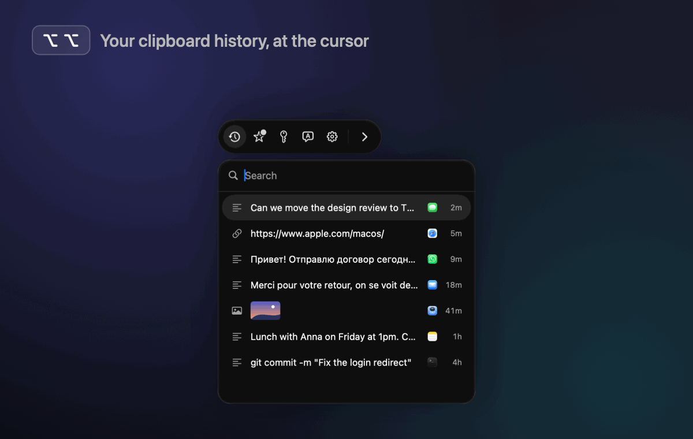

<div align="center">

# Sputnik

**Your clipboard, your voice and translation, right at your cursor.**<br>
A small menu-bar app for macOS. Everything runs on your Mac.

[](https://github.com/Omarbng/Sputnik/releases/latest)


<picture>
  <source media="(prefers-color-scheme: dark)" srcset="docs/images/hero-dark.png">
  
</picture>

</div>

## Get it

**One command.** Paste this into Terminal:

```sh
curl -fsSL https://raw.githubusercontent.com/Omarbng/Sputnik/main/scripts/install.sh | zsh
```

**Or download it:**

1. Download the `.dmg` from the [latest release](https://github.com/Omarbng/Sputnik/releases/latest).
2. Drag **Sputnik** to **Applications** and open it.
3. macOS stops the first launch because the app isn't notarized: open **System Settings →
   Privacy & Security**, scroll down and click **Open Anyway**.

A short setup then asks for your languages and three permissions (keyboard, clipboard,
microphone). To dictate with fn, set **System Settings → Keyboard → Press 🌐 key to → Do Nothing**.

## The keys

| Press | To |
|---|---|
| <kbd>⌥</kbd> <kbd>⌥</kbd> (tap Option twice) | Open your clipboard history at the cursor |
| hold <kbd>fn</kbd> | Talk; let go and it's typed where you are |
| <kbd>⌃</kbd> <kbd>⌃</kbd> | Translate the selected text, in any app |
| <kbd>⇧</kbd> <kbd>⇧</kbd> | Proofread the selected text in place |
| <kbd>⌘</kbd> <kbd>K</kbd> in the popup | Actions for an item: translate, proofread, call, text from an image… |
| Menu bar → **Shortcuts…** | Every key and voice command |

## See it

<p align="center"></p>

<table>
  <tr>
    <td></td>
    <td></td>
  </tr>
  <tr>
    <td></td>
    <td></td>
  </tr>
</table>

## What it does

- **Clipboard history** that opens at your cursor: search it, paste with ↩ or ⌘1–9, paste several
  at once, save snippets, keep secrets behind Touch ID. Links lose their tracking junk; copied
  passwords and one-time codes disappear after 10 minutes.
- **Dictation:** hold fn, talk, let go. Tap ⇧ while talking to type it in another language, or ⌃
  to tell it what to do with the selected text ("make it shorter", "translate to German").
  Right ⌥ works too.
- **Translate and proofread anywhere:** select text in any app and tap ⌃ twice or ⇧ twice.
- **More in ⌘K:** text from images, background removal, smaller images, and WhatsApp, call, email
  or Calendar when the text has a number, an address or a date.

## Your languages

Pick the language you write in and any others you read, from the 20 that Apple translates on the
Mac: Arabic, Chinese (Simplified and Traditional), Dutch, English, French, German, Hindi,
Indonesian, Italian, Japanese, Korean, Polish, Portuguese, Russian, Spanish, Thai, Turkish,
Ukrainian and Vietnamese. Dictation works in up to three at once (all except Hindi, Indonesian,
Polish and Ukrainian, which Apple doesn't recognise yet).

<p align="center"></p>

## Private by design

- No account, no cloud, no tracking. Apple's on-device engines translate, recognise speech and
  rewrite; their language files download once.
- History stays in `~/Library/Application Support/ClipDock` on your Mac; secrets stay in your
  Keychain; audio never leaves memory.
- Logs hold counts and timings, never what you copied or said.

## Build it yourself

You need the Command Line Tools (`xcode-select --install`) with Swift 6.2.

```sh
git clone https://github.com/Omarbng/Sputnik.git
cd Sputnik
scripts/run.sh       # build, install to ~/Applications and launch
scripts/test.sh      # unit tests
scripts/release.sh   # a .dmg in dist/
```

Builds are signed with the certificate named in `SIGN_IDENTITY`. Without one, `run.sh` signs ad
hoc and macOS asks for the permissions again after each build; a self-signed code-signing
certificate (Keychain Access → Certificate Assistant) avoids that.

How the code is organised: [docs/ARCHITECTURE.md](docs/ARCHITECTURE.md).

## Licence

MIT. See [LICENSE](LICENSE).
